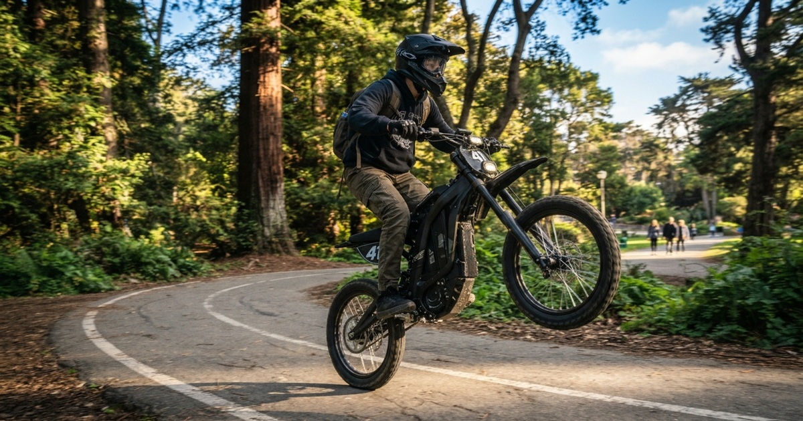

An "e-bicyclist" in San Francisco, circa 2026.
 
We've watched e-bikes go from novelty to fixture in a pretty short window. And yet I, for one, remain unconverted.
 
My problem isn't so much the technology—they're beautiful machines in many cases—but the 32-year-old fella serenely ripping through the Mission District at 30 mph. I say to this homeboy: get an acoustic bike. Work your quads. And if you can't or won't, at least get out of the bike lane.
 
If you recall, e-bikes arrived in the late 2010s with dockless bikeshare (e.g., JUMP) but really ramped during the COVID pandemic, hitting 1.1 million imports in 2022, exceeding electric cars.[^1]

You might think that e-bikes are enabling people who can't manage traffic or SF hills on a regular bike—pregnant women, the disabled, the elderly—to get around. A charitable theory. But a Portland State survey of North American owners found the market still dominated by white, male, affluent riders.[^2]

Still, in fairness, the legal ones are doin' real good. A UC Davis study of three Northern California rebate programs found owners replaced one to three car trips a week with their e-bikes.[^3] It *is* helpful to remember this is an automobile substitute first and foremost, not a means by which an existing cyclist goes soft. So if our white, male, affluent rider is leaving his 4Runner at home more often, that's real CO2 diverted, and I'm for it.

My issue is with the things that *aren't* e-bikes. Take my aforementioned 32-year-old, now weaving through pedestrians on John F. Kennedy Drive in Golden Gate Park at four o'clock on a Tuesday, isn't on an e-bike; he's on a crotch rocket with pedals. And he's not alone: surveys at Marin and San Mateo County middle and high schools found 88% and 87% of students' "e-bikes" weren't legal e-bikes.[^4]
 
## The Device: Assist vs. Throttle
 
It's worth qualifying which machines I'm talking about. California sorts e-bikes into three classes:[^5]
 
| Class | Operation | Max Speed | Reqs |
| :---: | --- | --- | --- |
| 1 | Pedal-assist only | 20 mph | Standard bike rules |
| 2 | Throttle; no pedal req'd | 20 mph | Impound bike if rider <16 |
| 3 | Pedal-assist only | 28 mph | Speedometer, helmet, riders 16+ |
 
Anything over 750 watts is legally a moped or motorcycle, not an e-bike.
 
Oh, and if they lack pedals they don't qualify as an e-bike either...
 
<iframe width="458" height="815" style="max-width:100%" src="https://www.youtube.com/embed/t3L3hbz2XtQ" title="If you&#39;re not using the pedals, just take them off honestly." frameborder="0" allow="accelerometer; autoplay; clipboard-write; encrypted-media; gyroscope; picture-in-picture; web-share" referrerpolicy="strict-origin-when-cross-origin" allowfullscreen></iframe>

After installing our first bidet a year or so ago, I've started wondering what *else* the Europeans are right about and/or we're slow to figure out, and here's another example: they do e-bike = pedal-only + 250 watts max (15.5 mph); else, get a moto, Amico.
 
The Mineta Institute has recommended California move toward this model. Instead we got SB 1167, which stops sellers from calling e-motos e-bikes but really does nothing about the guy already riding one.[^6]
 
## Leg Day
 
The labels are coming January 1. Until then, all I'm askin' for is a little shame. The humble bicycle is a miracle of 19th-century engineering: no battery to catch fire, no app, no firmware update, no unlock code. Its top speed is essentially determined by how often you skipped leg day. And every hill in this city is a free quad workout.
 
So I will tolerate pedal-assist (with slightly turned-up nose). But full throttle? No, Sir. You have two great options: either upgrade to a real motorcycle—I'd recommend Triumph—or get in shape by rockin' an acoustic.
 
— ᴘ. ᴍ. ʙ.
 
[^1]: California State Assembly, Committee on Transportation, [*AB 1557 (Papan): Vehicles: Electric Bicycles*](https://atrn.assembly.ca.gov/system/files/2026-04/1557.pdf), bill analysis, April 20, 2026, 3.
 
[^2]: Cameron Steven Bennett, ["A Survey of North American Electric Bicycle Owners"](https://pdxscholar.library.pdx.edu/open_access_etds/6605/) (master's thesis, Portland State University, 2024).

[^3]: Assembly Committee on Transportation, *AB 1557 Analysis*, 3. 
 
[^4]: Assembly Committee on Transportation, *AB 1557 Analysis*, 4–5.
 
[^5]: Cal. Veh. Code § 312.5; summarized in Assembly Committee on Transportation, *AB 1557 Analysis*, 1–2, 6.
 
[^6]: Assembly Committee on Transportation, *AB 1557 Analysis*, 6; ["California Signs into Law Legislation to Differentiate E-Motos from E-Bikes,"](https://bicycleretailer.com/industry-news/2026/10/01/california-signs-law-legislation-differentiate-e-motos-e-bikes) *Bicycle Retailer and Industry News*, October 1, 2026.