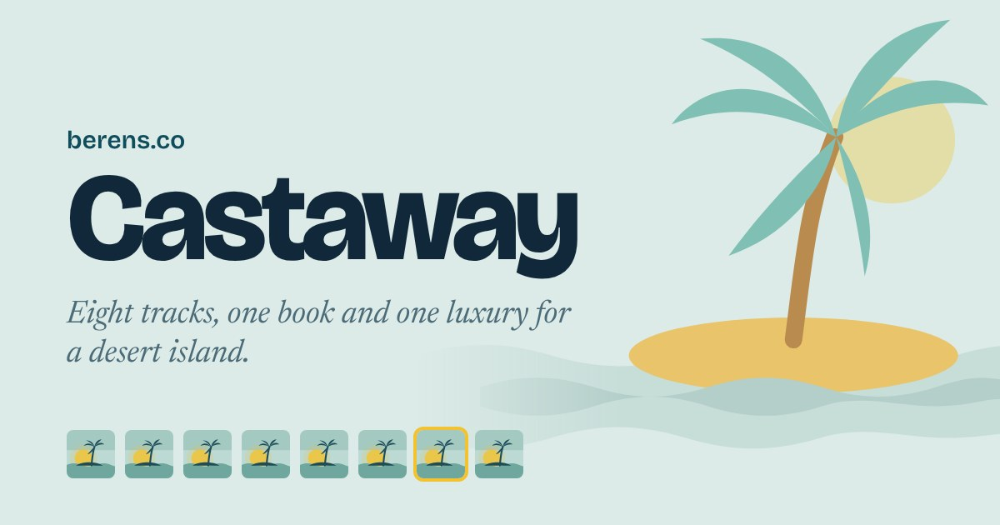

In [Rebirth of the Album](/rebirth-of-the-album.html) I made the case for the album as an art form, front to back at 33⅓ rpm, and then committed the sin of ranking my top 20. This time I'm zooming in a level: from the album to the individual song (or "track," or "disc" if you're British[^disc]).

## Cast away

*Desert Island Discs* has been running on BBC radio since 1942, which makes it older than the LP itself. The premise is simple: a guest is cast away to a desert island and allowed to bring eight recordings, one book and one luxury. The Bible and the complete works of Shakespeare are already included. Between the tracks they talk about why each one matters, which is a poignant way of starting to understand who someone is: what do you laugh at, what do you cry at, what gets you pumped up, what do you find beautiful?

I went through a stretch of listening to it pretty consistently, enough for it to get into my head, and before long I was applying the filter to my own musical environs: a great song comes up on the home speaker or in the car and I'm wondering, *would this make the cut for my desert island?*

## From 366 to 8

This isn't my first exercise in music curation. For my [Song Bot](/song-bot.html) I whittled my favorite songs down to 366, one for every day of the year. This is the same exercise run through a much finer sieve: if 366 was a curation, eight is a bloodsport.

The rules I set myself:
- One track per artist
- At least one live track
- Bias toward older (per the [Lindy Effect](/systems/)), but if you can boldly call a newer one, more power to ya

So here's mine:

<iframe src="https://castaway.berens.co/e2hhgd3?embed=1" title="Eight tracks for a desert island" width="100%" height="380" style="border:0;max-width:44rem" loading="lazy"></iframe>

I know this tends toward the sad and melancholic and adult contemporary soft-rocky, but what can I say: I'm a sensitive fella. (Also, this is subject to change, which is why I made Castaway editable--I've already got a bunch of honorable mentions that barely missed the list[^hm].)

[^hm]: **Song honorable mentions**: [My Wasted Friends](https://music.youtube.com/watch?v=d9Kj1kp8zKk) (Ike being our official family rock band), [Going to California](https://music.youtube.com/search?q=Going%20to%20California%20Led%20Zeppelin) (biographical), or [Good Times Bad Times](https://music.youtube.com/watch?v=2u-n__lHhWU) (true rock 'n' roll with apt lyrics for a castaway: "I know what it means to be alone; I sure do wish I was at home."); [#41](https://music.youtube.com/watch?v=SYCxdWaN6iU) by DMB; [Thunder Road (Live at the Roxy, 1975)](https://music.youtube.com/watch?v=YgRC8n2zuHY) from the album that really got me into the Boss. And so many classical contenders: [Andante cantabile, Op. 11](https://music.youtube.com/watch?v=LMKeYFTlj5E), [Swan Lake Suite, Op. 20a: II. Valse](https://music.youtube.com/watch?v=hxAsJGflQCg), [Flower Duet (Duo des fleurs)](https://music.youtube.com/watch?v=ZnCJ3OUv-bc), [Laudate Dominum](https://music.youtube.com/watch?v=wNlG_grvGyY) (faith, and one of our wedding songs), [Gabriel's Oboe](https://music.youtube.com/watch?v=lArnKBTe82I), [Brandenburg Concertos](https://music.youtube.com/watch?v=bpeuh7SEX3o) (Exquisite, but more than anything because Lisa loves them). **Book honorable mentions**: It's nearly a toss-up between the *Divine Comedy* and the *Summa Theologiae*, but the *Summa* wins out as something I could ruminate on for months and years, and read and re-read. If the Lord himself put his stamp of approval on it ("Thomas, you have written well of me"), that's good enough for me. (And Sts. Peter and Paul [personally helped him with it](https://youtube.com/shorts/nwKRqS44sQE)?!) **Luxury honorable mention:** If I'm called on the plumbing and electricity technicality, then an AeroPress or similar coffee-brewing device.

## Your turn

That's where [Castaway](https://castaway.berens.co) comes in. Pick your eight, say why for each if you like, choose the one you'd save from the waves, add a book and a luxury, and you get a short link to share. Each track gets links to Apple Music, Spotify and YouTube Music, so whoever opens your list can listen on whatever they use (or, for a one-off live recording like my Backstreets, just the link to that exact recording). There's also an embed card, like the one above, if you have a site of your own.

No accounts, no ads, no algorithm; just eight songs and the reasons behind them, which turns out to be a pretty good conversation starter.

## How I built this

Like Song Bot, this was a collaboration with Claude, and it came together in two phases.

**Phase 1: the prototype.** In a regular claude.ai chat (Fable 5.2 during the free trial). The whole app was a single HTML file with no server at all: your entire list was compressed and stuffed into the link itself. That's cool and free to host, but the links ran to about 1,000 characters, and once shared a list could never be changed. So I got that working, and then had some limitations to solve in...

**Phase 2: making it real.** Claude Code (Claude Opus 5.5), working in the cloud on the GitHub repo. It went something like this:

- Test the prototype against the real world. The chat that built it had never been able to touch the internet, so a few things were assumed rather than checked. Most of it held up; one link was quietly sending everyone to the US Apple Music store.
- Write automated tests (there are now 32) so nothing breaks unnoticed.
- Move the site onto Cloudflare: a small program (a "Worker") + a little database, at castaway.berens.co.
- Move berens.co's DNS from Namecheap to Cloudflare without breaking my email. This was my leap-of-faith part.[^dns]
- Short links, editing your list after publishing (without accounts), link previews (for Slack and Signal and the like), an icon, sharing.
- Spam defenses before rolling this thing out: rate limits, music-only links, a report button.

A few dead ends along the way: the service the first version used to match songs across Apple, Spotify and YouTube stopped offering free access this summer,[^odesli] and Spotify has locked down its developer access so tightly that building on it probably isn't worth it. So search runs on Apple's free catalog, and the other services get links that search for the song.

**The setup:**

- **Cloudflare Worker + D1 database.** Serves the pages and stores the lists. Every save is kept as a new version, so there's a history.
- **Apple's iTunes Search API.** Track search and cover art, free and keyless.
- **No accounts.** Whoever creates a list gets a secret edit link; the database only keeps a scrambled fingerprint of it.
- **Cost:** nothing so far, but there are certain features I may add that could change that.

## Parting thoughts

With each of these projects there's less intervention required on my part, because the models are more self-sufficient. This is a good thing, but it makes me wonder if the [lack of friction](/spanish.html) is costly to my own learning. Onus on me to get into the code on the things I didn't struggle through, so I understand them well.

So go on and make your own eight at [castaway.berens.co](https://castaway.berens.co). Then send me the link: I want to know what you'd save from the waves.

— ᴘ. ᴍ. ʙ.

[^disc]: The show's name comes from the 78 rpm discs it played in the early years.
[^dns]: DNS is the internet's address book. Moving it means copying every record to the new provider exactly, including the ones that prove your email is really from you. Miss one and your mail quietly lands in people's spam folders.
[^odesli]: Odesli, the company behind song.link. Its free access ended on 31 July 2026.
